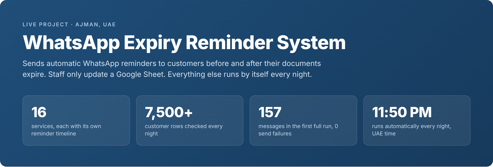
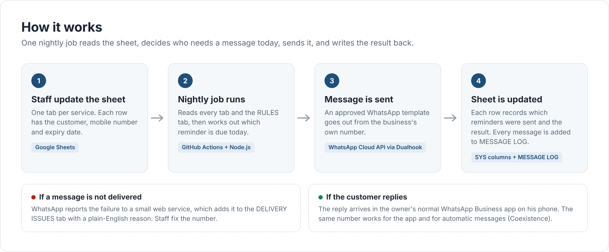
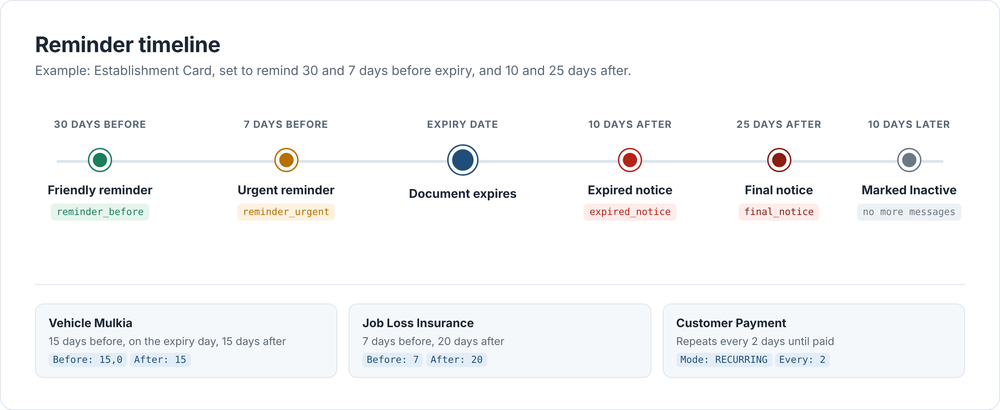
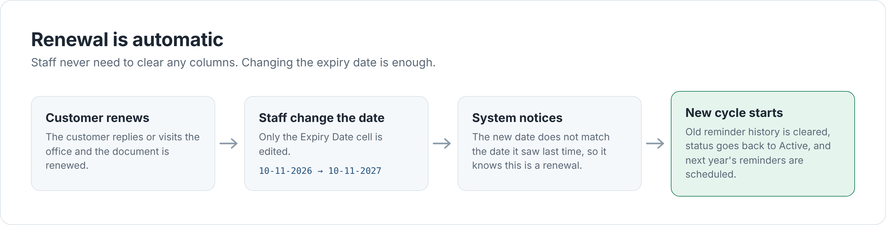
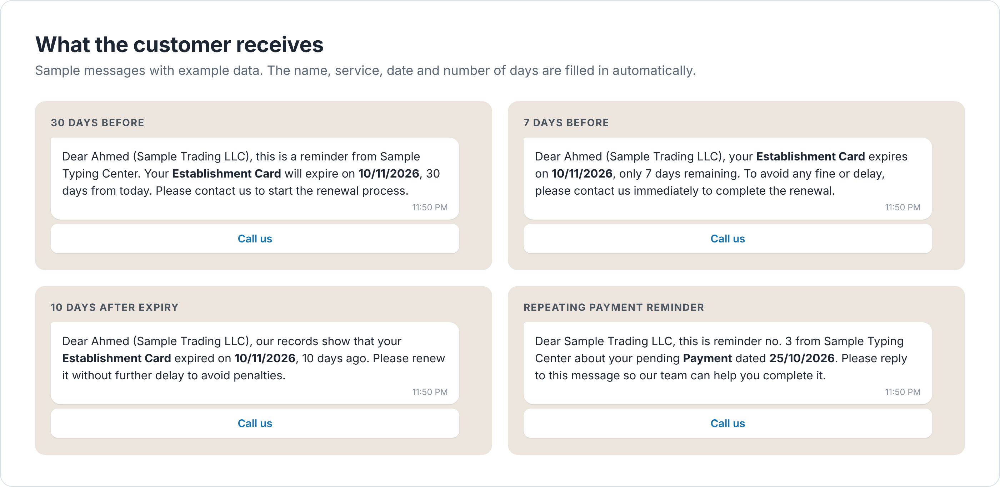
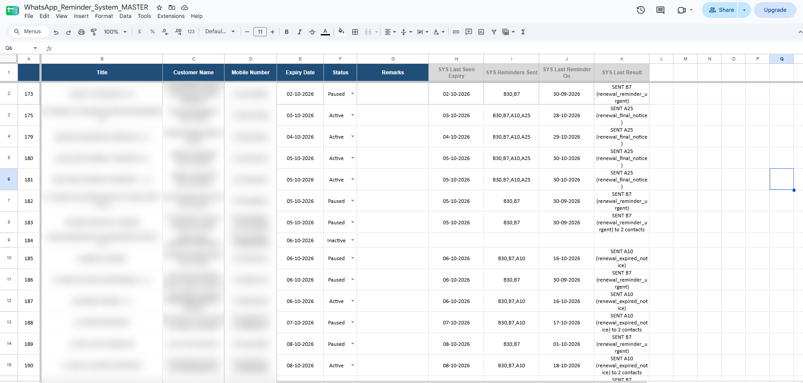
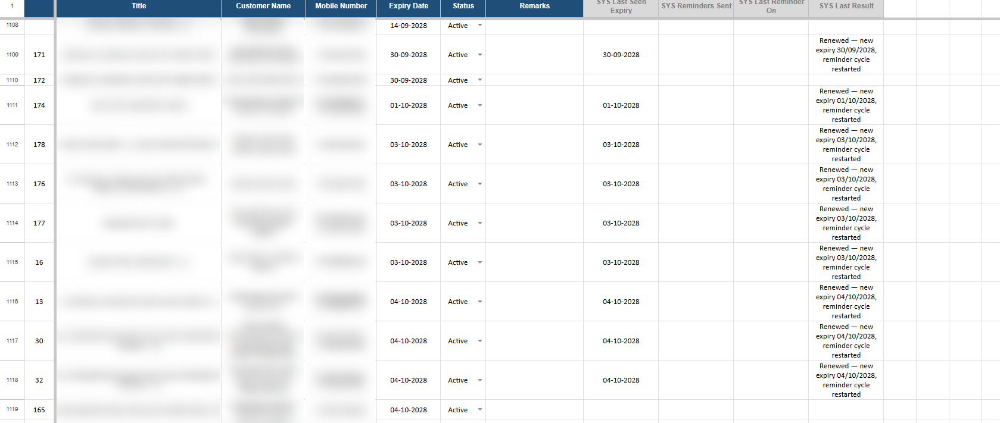
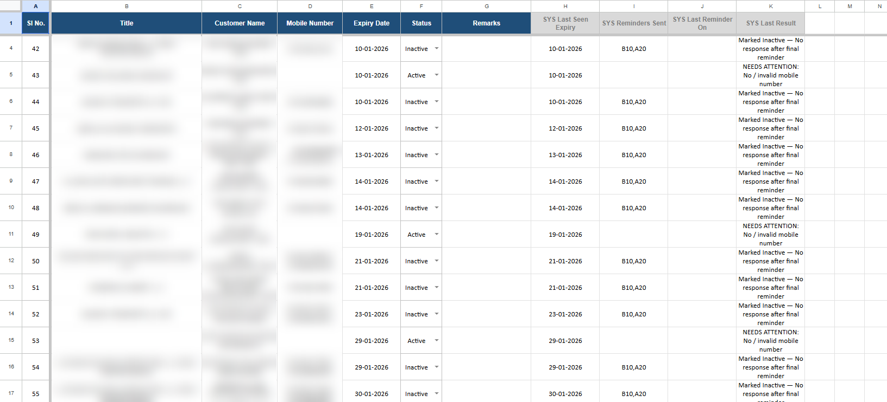
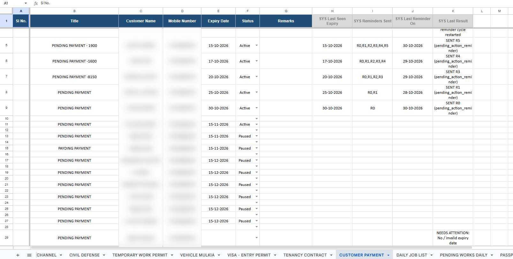
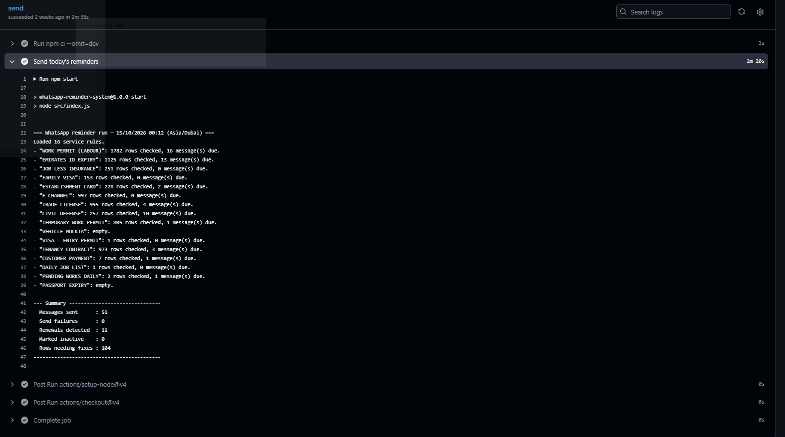

# WhatsApp Expiry Reminder System



An automatic system that sends WhatsApp reminders to customers before and after their documents expire.

It was built for a typing and document services business in Ajman, UAE. The business handles work permits, Emirates IDs, trade licenses, visas and many other documents, with more than 7,500 customer records. Before this system, staff had to check expiry dates by hand and message each customer one by one. Now the staff only keep a Google Sheet up to date, and the system does the rest every night.

The system has been running live since September 2026.

---

## Contents

- [The problem](#the-problem)
- [The solution](#the-solution)
- [Features](#features)
- [How it works](#how-it-works)
- [Reminder timeline](#reminder-timeline)
- [What the customer receives](#what-the-customer-receives)
- [Screenshots from the live system](#screenshots-from-the-live-system)
- [Tech stack](#tech-stack)
- [Project structure](#project-structure)
- [Setup](#setup)
- [Commands](#commands)

---

## The problem

- The business has 16 different services. Each one has its own expiry rules.
- Some customers need a reminder 30 days before, some 7 days before, some after the expiry date.
- Thousands of customers are spread across many Excel sheets.
- Checking dates by hand takes hours, and customers are often missed.
- A missed renewal means fines for the customer and lost work for the business.

## The solution

- All customers live in one Google Sheet, with one tab for each service.
- A **RULES** tab says when each service should get reminders.
- Every night at 11:50 PM (UAE time), a job reads the sheet and sends the reminders that are due that day.
- Messages are sent from the business's **own WhatsApp number**, so customers see a name they already know.
- The owner still uses the normal WhatsApp Business app on his phone. Customer replies come to him as usual.

---

## Features

**Reminders**

- Different reminder days for each service, set in the RULES tab. No code change is needed.
- Reminders before expiry, on the expiry day, and after expiry.
- Repeating reminders for pending work, for example "every 2 days until the payment is made".
- Five approved WhatsApp message templates cover all 16 services.
- Each message is personal. It includes the customer or company name, the service, the expiry date and the number of days left or passed.
- A "Call us" button in every message.

**Automatic handling**

- **Renewal:** when staff change the expiry date, the system notices it and starts a fresh reminder cycle for the new date.
- **Inactive:** if a customer does not respond after the last reminder, the row is marked Inactive and no more messages are sent.
- **Pause:** staff can set a row to Paused to stop reminders for that customer.
- **New customers:** a new row is picked up automatically on the next run.
- **New services:** add a new tab and one line in the RULES tab.

**Mobile numbers**

- Accepts numbers in many styles: `+971 50 123 4567`, `0501234567`, `971501234567`.
- One cell can hold several numbers. Each number gets the message.
- Wrong or unreadable numbers are reported in the sheet, not skipped silently.

**Safety**

- **Grace window:** if a row is added late, old reminders are not sent all at once. Only reminders from the last few days are sent.
- **Same-person limit:** WhatsApp allows one message every 6 seconds to the same number. The system waits automatically when one customer has several services due on the same day.
- **Retry:** if WhatsApp is busy, the system waits and tries again.
- **Dry run mode:** shows exactly what would be sent without sending anything or changing the sheet.
- **Setup check:** one command checks the sheet, the rules, every phone number and date, and the WhatsApp connection before going live.

**Records**

- Four system columns on every row show what happened: last seen expiry, reminders sent, last reminder date and last result.
- **MESSAGE LOG** tab: one line for every message sent.
- **DELIVERY ISSUES** tab: messages that WhatsApp could not deliver, with the reason in plain English (for example, "Number is not on WhatsApp").

---

## How it works



1. Staff add or update customers in the Google Sheet.
2. Every night, a GitHub Actions job runs the Node.js program.
3. The program reads the RULES tab and every service tab. For each customer it decides: send a reminder today, restart the cycle, mark as inactive, or do nothing.
4. Reminders are sent through the official WhatsApp Business Platform (Cloud API), using Dualhook as the provider.
5. The result is written back to the sheet, and every message is added to the MESSAGE LOG.
6. A few minutes later, WhatsApp reports whether each message was delivered. A small webhook on Vercel catches any failures and adds them to the DELIVERY ISSUES tab.

---

## Reminder timeline



Each service has its own line in the RULES tab:

| Service Tab Name | Display Name | Mode | Before Expiry (days) | After Expiry (days) | Repeat Every (days) | Max Repeats | Enabled |
|---|---|---|---|---|---|---|---|
| ESTABLISHMENT CARD | Establishment Card | OFFSET | 30,7 | 10,25 | | | YES |
| VEHICLE MULKIA | Vehicle Mulkia | OFFSET | 15,0 | 15 | | | YES |
| JOB LESS INSURANCE | Job Loss Insurance | OFFSET | 7 | 20 | | | YES |
| CUSTOMER PAYMENT | Payment | RECURRING | | | 2 | 6 | YES |

- **OFFSET** means "send on fixed days before and after the expiry date". `0` means on the expiry day itself.
- **RECURRING** means "send again every few days", up to the maximum number of times.

### Renewal is automatic



The system remembers the expiry date it saw last time. If staff change the date, it knows the customer has renewed. It clears the old reminder history and starts again for the new date.

---

## What the customer receives



These are sample messages with example data. The exact wording comes from the templates approved by Meta.

| When | Template name |
|---|---|
| First reminder before expiry | `renewal_reminder_before` |
| Last reminder before expiry | `renewal_reminder_urgent` |
| First notice after expiry | `renewal_expired_notice` |
| Last notice after expiry | `renewal_final_notice` |
| Repeating reminder | `pending_action_reminder` |

All templates are in the **Utility** category, which is the lower-cost category on WhatsApp.

---

## Screenshots from the live system

Customer names, company names and mobile numbers are blurred to protect privacy.

### Reminders sent and recorded

Each row shows which reminders were sent (B30 = 30 days before, B7 = 7 days before, A10 = 10 days after, A25 = 25 days after), when the last one went out, and the result. Some rows show "to 2 contacts" because that customer has two mobile numbers.



### Renewals detected

Staff changed these expiry dates to 2028. The system noticed the change and restarted the reminder cycle on its own.



### Inactive rows and rows that need attention

Customers who did not respond after the final reminder are marked Inactive. Rows with a missing mobile number are flagged as "NEEDS ATTENTION" so staff can fix them.



### Repeating payment reminders

The Customer Payment tab uses a repeating rule. R0, R1, R2... show each reminder that has been sent. The tab names at the bottom show some of the 16 services.



### Nightly run on GitHub Actions

One real nightly run: 16 service tabs and more than 7,500 rows checked in about 2 minutes, 51 messages sent, 0 failures, 11 renewals detected.



---

## Tech stack

| Part | Technology |
|---|---|
| Language | JavaScript (Node.js 20, ES modules) |
| Database | Google Sheets, through the Google Sheets API (service account) |
| Scheduler | GitHub Actions (cron job, every night) |
| Messaging | WhatsApp Business Platform (Cloud API) with approved message templates |
| WhatsApp provider | Dualhook (Coexistence: the same number works in the WhatsApp Business app and the API) |
| Webhook | Vercel serverless function |
| Libraries | `googleapis`, `dotenv` |

The code also supports sending directly through Meta or through 360dialog. You only change one setting.

---

## Project structure

```
whatsapp-reminder-system/
├── .github/workflows/
│   └── daily-reminders.yml   Nightly schedule on GitHub Actions
├── api/
│   └── webhook.js            Vercel function: saves failed deliveries to the sheet
├── docs/images/              Images used in this README
├── scripts/
│   ├── check-setup.js        Checks sheet, rules, numbers, dates and WhatsApp connection
│   ├── simulate.js           Plays reminder scenarios offline, no sheet or WhatsApp needed
│   └── test-send.js          Sends one test message
├── src/
│   ├── index.js              Starting point
│   ├── engine.js             Main loop: reads tabs, sends messages, writes results
│   ├── rules.js              Reads the RULES tab and decides what is due today
│   ├── templates.js          Builds each message from the right template
│   ├── whatsapp.js           Sends messages, handles rate limits and retries
│   ├── sheets.js             Reads and writes the Google Sheet
│   ├── phone.js              Cleans and checks mobile numbers
│   ├── dates.js              Date helpers in UAE time
│   └── config.js             Settings from environment variables
├── .env.example
└── package.json
```

---

## Setup

**What you need**

- Node.js 20 or newer
- A Google Sheet with the tabs RULES, MESSAGE LOG, DELIVERY ISSUES and one tab per service
- A Google Cloud service account with access to that sheet (shared as Editor)
- A WhatsApp Business number connected through Dualhook (or Meta directly), with the five templates approved

**Sheet columns for every service tab**

`Sl No.` | `Title` | `Customer Name` | `Mobile Number` | `Expiry Date` | `Status` | `Remarks` | `SYS Last Seen Expiry` | `SYS Reminders Sent` | `SYS Last Reminder On` | `SYS Last Result`

Staff fill in the first seven columns. The four SYS columns are filled in by the system.

**Steps**

1. Clone the repository and install:
   ```
   npm install
   ```
2. Copy `.env.example` to `.env` and fill in your values.
3. Check everything:
   ```
   npm run check-setup
   ```
4. Do a test run with `DRY_RUN=true` in `.env`:
   ```
   npm start
   ```
5. On GitHub, add these values in **Settings > Secrets and variables > Actions**:
   - Secrets: `SHEET_ID`, `GOOGLE_SERVICE_ACCOUNT_JSON`, `WHATSAPP_PHONE_NUMBER_ID`, `DUALHOOK_API_KEY`
   - Variables: `BUSINESS_NAME` and, if needed, `WHATSAPP_PROVIDER`, `WHATSAPP_LANG`, `DEFAULT_COUNTRY_CODE`, `GRACE_DAYS`, `INACTIVE_AFTER_DAYS`, `DRY_RUN`
6. Deploy the project to Vercel for the webhook. Add `SHEET_ID`, `GOOGLE_SERVICE_ACCOUNT_JSON` and `WHATSAPP_VERIFY_TOKEN` there. Then set the webhook URL `https://<your-project>.vercel.app/api/webhook` in Dualhook.

---

## Commands

| Command | What it does |
|---|---|
| `npm start` | Runs the reminders for today |
| `npm run check-setup` | Checks the full setup and lists any problems |
| `npm run simulate` | Shows what each type of customer would receive over time, without using the sheet or WhatsApp |
| `npm run test-send -- 971501234567 renewal_reminder_before` | Sends one test message to the given number |

**Main settings** (in `.env` or GitHub variables)

| Setting | Default | Meaning |
|---|---|---|
| `GRACE_DAYS` | 5 | A missed reminder is still sent if it is at most this many days late |
| `INACTIVE_AFTER_DAYS` | 10 | Days after the last reminder before a row is marked Inactive |
| `DEFAULT_COUNTRY_CODE` | 971 | Added to local numbers like 0501234567 |
| `DRY_RUN` | true in `.env.example` | When true, nothing is sent and the sheet is not changed |
